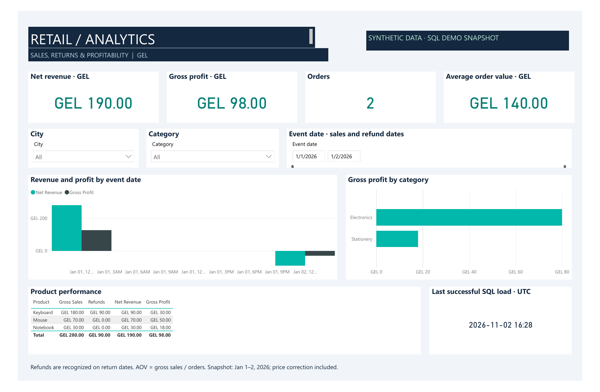

# Retail Analytics Platform

[](https://github.com/David-saytrue/retail-analytics-platform/actions/workflows/ci.yml)

An end-to-end Data Engineering / BI portfolio project using synthetic retail data.
Python ingests sales and returns into PostgreSQL; SQL builds a warehouse and
validated financial marts. A working Power BI report and editable project are included in [powerbi](powerbi/README.md).
The report defaults to a verified synthetic SQL snapshot and supports switching to
PostgreSQL import; direct connector refresh has not yet been verified.
Apache Airflow 3.3.1 orchestrates immutable file ingestion, transactional warehouse
publication and quality checks every day at 06:00 Asia/Tbilisi.

## Report preview



Actual Power BI report export using the verified synthetic SQL snapshot.
Download the [interactive PBIX](powerbi/Retail%20Analytics/Retail%20Analytics.pbix) to explore filters.

## Complete local demo: Windows / PowerShell 7

With Docker Desktop running, use the helper from this repository:

```powershell
./scripts/retail.ps1 -Action Start
./scripts/retail.ps1 -Action PrepareDemo
./scripts/retail.ps1 -Action Trigger
./scripts/retail.ps1 -Action Status
./scripts/retail.ps1 -Action CopyAirflowPassword
```

Open [local Airflow](http://localhost:8086) as `admin` and paste the copied password.
The helper preserves database credentials in ignored, Windows-user-encrypted local
storage. It will not invent new passwords for existing database volumes.
Read the [Airflow runbook](airflow/README.md) for setup, input contracts, retries,
failure recovery and other operating systems.

Open [Retail Analytics.pbix](powerbi/Retail%20Analytics/Retail%20Analytics.pbix)
in Power BI Desktop. [Editable PBIP source](powerbi/Retail%20Analytics/Retail%20Analytics.pbip)
is included beside it. The verified embedded SQL snapshot shows net revenue **190 GEL**,
gross profit **98 GEL**, **2 orders** and average order value **140 GEL**.
Its PostgreSQL source switch is prepared; direct connector refresh still requires
local credentials and has not been verified. Airflow does not refresh the PBIX.

The application database is available at `127.0.0.1:55432`; Airflow uses a separate
metadata database. Other Compose projects are not part of this deployment.
Stop only this stack without deleting data using `./scripts/retail.ps1 -Action Stop`.

## What the project demonstrates

- Python validates synthetic source data before publishing it to PostgreSQL.
- Raw versions preserve updates; staging selects source-time latest values.
- A star schema and financial marts handle historical costs and partial returns.
- Airflow polls immutable SHA-256-verified packages and retries safely.
- A packaged Power BI report explores sales, refunds, margins, cities and categories.
- CI verifies Python behavior, PostgreSQL rollback/replay and the actual Airflow DAG.

The minimal commands below are an alternative manual setup. Reuse the original
database password if a volume already exists; changing an environment variable
does not change the stored PostgreSQL password.

## Quick start: Docker and PowerShell

Run from this directory with Docker Desktop running:

```powershell
$env:RETAIL_DB_PASSWORD = Read-Host 'Password for the new local demo database'
docker compose up -d --wait db
docker compose run --rm app generate
docker compose run --rm app load --batch data/generated/day1.json --costs data/generated/costs.csv
docker compose run --rm app report
docker compose run --rm app load --batch data/generated/day2.json
docker compose run --rm app report
docker compose run --rm app load --batch data/generated/day2.json
docker compose run --rm app check
docker compose run --rm app load --batch data/generated/day3-correction.json
docker compose run --rm app report
```

The first app run builds the image and needs Docker Hub and Debian package access.
The password initializes a new database volume; changing the variable later does
not change an existing database password. Stop without removing data using
`docker compose stop`.

## Native setup: Python 3.10+ and PostgreSQL 17+

Use a dedicated database created for this project, never an existing learning or
production database. No Python packages are required. Adjust connection settings:

```powershell
$env:PSQL = 'C:\Program Files\PostgreSQL\17\bin\psql.exe'
$env:PGHOST = '127.0.0.1'
$env:PGPORT = '55432'
$env:PGDATABASE = 'retail'
$env:PGUSER = 'retail'
$env:PGPASSWORD = $env:RETAIL_DB_PASSWORD
python retail.py generate
python retail.py load --batch data/generated/day1.json --costs data/generated/costs.csv
python retail.py load --batch data/generated/day2.json
python retail.py report
python retail.py check
```

Alternatively use pgpass.conf. Credentials are inherited through PG* environment
variables, never passed as command-line arguments. Application schemas are
created automatically.

## Demo and expected results

- Day 1: two orders, three lines, revenue 260 GEL, COGS 152, gross profit 108.
  Order 1 has two lines. Average order value is 260 / 2 = 130.
- Day 2: one keyboard is returned. Its discounted price was 90 and cost was 60.
  All-period net revenue becomes 170, net COGS 92, gross profit 78.
- Repeating day 2 inserts zero new versions and leaves financial results unchanged.
- Day 3 corrects the mouse price from 50 to 70. Net revenue becomes 190 and
  gross profit 98. Replaying the older day 1 cannot undo the correction.

Generate a larger dataset with `python retail.py generate --extra-orders 10000`.
The default seed is 42. Do not load a different seed into the same database:
conflicting payloads with identical business keys and timestamps are rejected.

## Ingestion and reliability

Python validates input fields, dates and decimal money strings. Each database
attempt is recorded in ops.runs. A single transaction serializes publication,
accepts raw versions, refreshes the model, runs quality checks and marks success.
Failure rolls back raw and model changes; failed status is recorded separately.
Malformed input is rejected before connecting and has no database run entry.

Raw stores accepted source versions, JSON payloads, ingestion timestamps and run
IDs. The version key is entity + record ID + source updated_at. Exact duplicates
are skipped; different payloads with the same version key fail. staging.latest
selects the newest source timestamp rather than the latest arrival.

Batches can contain only changed records. Late events are not filtered by a
global watermark. Missing records do not imply deletion.

## Model and business rules

- fact_sales grain: one order line; fact_returns grain: one return event.
- Shared dimensions: customer, product and date. Customer/product attributes use
  Type 1 updates; historical attribute labels would require an SCD2 extension.
- product_cost contains effective dates. Sales use the most recent cost effective
  on the sale date. Missing historical costs fail; future costs do not rewrite
  past profit. Correcting a historical cost intentionally restates affected sales.
- Currency: GEL; amounts use NUMERIC with two decimals. Tax, shipping, cancellations
  and currency conversion are outside the first version.
- Discount is the total line discount, not a per-unit discount.
- Returns refund the proportional discounted sale price and restore usable stock
  at the original cost. Damaged inventory requires a separate write-off rule.
- Cumulative allocation preserves cents across multiple partial returns.
- mart.sales_line aggregates returns before joining, preserving sales grain.
- mart.movements recognizes sales on sale dates and refunds on return dates.
  mart.daily_finance aggregates those movements by day.
- mart.freshness separates successful load time from the latest source timestamp.

## Verification and current limitations

See [recorded validation results](docs/validation.md).

```powershell
python -m unittest discover -s tests -v
# Only against a dedicated EMPTY test database:
$env:RETAIL_TEST_DB = '1'
python tests/integration.py
```

Integration tests reject existing application schemas and never reset databases.
Use a fresh test database for each run. Coverage includes retries, corrections,
old batches, partial returns, historical costs, rounding and atomic rollback.
SQL validates references, quantities, source reconciliation and order consistency.

Raw ingestion is incremental; the SQL model currently refreshes from all latest
versions. This is not an optimized million-row pipeline. Abrupt termination can
leave a running audit entry. Stale-run detection, deletion handling, schema migrations
and concurrent-run tests remain future work. Airflow scheduling is implemented as a
local standalone deployment; production HA and external notifications are not configured.
Ready packages are retained and replayed rather than tracked in an optimized file catalog.
Transactions are atomic per package, not for an entire multi-package DAG run.

The [CI workflow](.github/workflows/ci.yml) runs unit tests and the end-to-end
PostgreSQL scenarios plus DAG import in the pinned Airflow image on push and pull request. It also supports manual runs.
See [GitHub Actions](https://github.com/David-saytrue/retail-analytics-platform/actions)
for the latest execution status.

## Learning path

1. Read [Lesson 1](docs/lesson-01.md), run the demo and explain each result.
2. Inspect raw.events, staging.latest, dwh tables and mart views in DBeaver.
3. Open the [Power BI report](powerbi/README.md), explain its measures and reconcile
   both all-period and filtered results against SQL.
4. Follow the [Airflow runbook](airflow/README.md), inspect successful tasks and explain
   how checksums, retries, transactions and quarantine handle failed input.
5. Optional extensions: a real external source, PostgreSQL-connected report refresh,
   monitoring/alerts, scaling and a short demo video.

Official references: [psql](https://www.postgresql.org/docs/17/app-psql.html),
[ON CONFLICT](https://www.postgresql.org/docs/17/sql-insert.html),
[PostgreSQL JSON](https://www.postgresql.org/docs/17/functions-json.html),
[Compose startup order](https://docs.docker.com/compose/how-tos/startup-order/).
